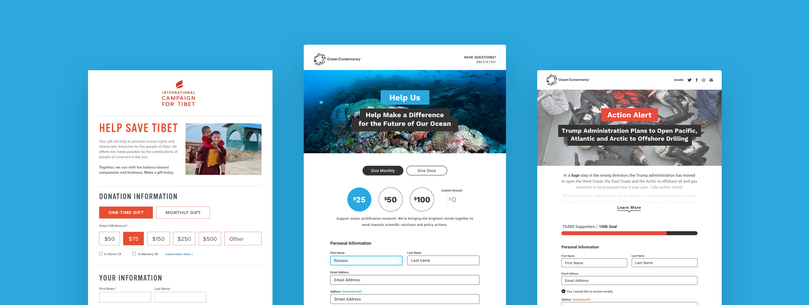

# ENgrid: page template framework for Engaging Networks

ENgrid is a free, open-source set of page templates for [Engaging Networks](https://www.engagingnetworks.net/) (EN). You keep building pages in EN's Page Builder the way you do today, and ENgrid adds 150+ features and enhancements that EN pages don't have out of the box.

A donation page that loads slowly, fails with a screen reader, or makes a returning donor retype their address loses gifts you already paid to earn. More than 30 organizations run their donation, advocacy and event pages on ENgrid.

| | |
| --- | --- |
| Cost | Free to use, change and share |
| Where you work | Engaging Networks Page Builder, the same as today |
| Who uses it day to day | Content admins, with no developer needed after setup |
| What's included | 72 features, 82 enhancements and 17 integration capabilities |
| Who maintains it | [4Site Studios](https://www.4sitestudios.com/engaging-networks/?ms=github), since 2017 |

## What you can do with ENgrid

A selection from each category is below, and the [full list](FEATURES.md) describes all 171. Accessibility, speed and fixes apply to every page with no setup. Most other features are switched on per page or per theme.

### Donations and payments

- The submit button shows the amount and frequency the donor has chosen
- Each giving frequency can have its own set of gift amounts
- Donors can tick a box to cover processing fees
- Donors can pay with Apple Pay, Google Pay, PayPal, Venmo or a donor-advised fund
- A gift below your minimum or above your maximum shows an error before the donor can submit
- Premium gifts are shown or hidden by gift amount and frequency

[All 36 in donations and payments](FEATURES.md#donations-and-payments)

### Upsells and conversion

- Ask one-time donors to switch to a suggested monthly amount when they submit
- Show an offer when a visitor moves to leave the page
- Ask for a second gift on the thank-you page
- Ask opt-in questions one at a time on the thank-you page (the opt-in ladder)

<!-- TODO before merge: confirm with NWF that these figures can be published here -->
The National Wildlife Federation's opt-in ladder collected 45,710 opt-ins from 21,190 supporters between October 2025 and October 2026, as presented at ENCC DC 2026.

[All 8 in upsells and conversion](FEATURES.md#upsells-and-conversion)

### Personalization and conditional content

- Returning supporters who gave consent have their details filled in for them
- Returning supporters are greeted by name
- Content is shown or hidden by gift amount, frequency, payment method or any option the supporter selects
- A link can switch a page to a different layout or content variant, with no duplicate page to maintain
- The supporter's country is selected for them

[All 18 in personalization and conditional content](FEATURES.md#personalization-and-conditional-content)

### Forms and fields

- A one-click link in an email can submit the form as soon as the page loads
- A form section collapses when its required fields are already filled
- Each field's error message appears beside the field
- Browser autofill works on supporter and card fields
- A progress bar shows supporters how far they are through a multi-page form

[All 19 in forms and fields](FEATURES.md#forms-and-fields)

### Advocacy, eCards and events

- Donors can send an eCard along with their gift
- An eCard page can become an action sent to a fixed recipient
- Event ticket prices are formatted in the local currency
- Share buttons and the click-to-call, tweet-to-target and letter-to-target blocks are restyled

[All 13 in advocacy, eCards and events](FEATURES.md#advocacy-ecards-and-events)

### Accessibility

- Screen readers announce which fields are required, which have errors, and a summary of the errors
- After a failed submit, focus moves to the first field that needs fixing
- Every page has a skip to main content link and visible keyboard focus outlines
- eCard and premium gift images get alt text

No template can guarantee compliance by itself, but you start from a much stronger baseline than a stock page.

[All 14 in accessibility](FEATURES.md#accessibility)

### Layout, media and display

- Choose one of six page layouts, with one or two columns, for each page
- Set a full-page background image or video, or cross-fade several images
- Add photo credits, click-to-expand sections and a scrolling ticker
- Images load only as they are needed, so pages appear sooner

[All 22 in layout, media and display](FEATURES.md#layout-media-and-display)

### Data quality and validation

- Names, addresses and cities are capitalized on submit
- Email addresses are checked in real time with FreshAddress or NeverBounce
- US addresses and phone numbers are standardized with TidyContact, a paid service
- US ZIP codes are validated and formatted

[All 9 in data quality and validation](FEATURES.md#data-quality-and-validation)

### International

- Address fields are relabeled for 10 countries
- The currency list changes with the supporter's country
- Supporters who choose a country you specify are sent to another page
- ENgrid's own text comes in English and Spanish and can be extended

[All 7 in international](FEATURES.md#international)

### Embeds

- EN forms placed inside your website, or inside other EN pages, resize to fit
- Several embedded forms submit one after another so records are not lost

[All 7 in embeds](FEATURES.md#embeds)

### Analytics and tracking

- Page details, campaign link parameters, opt-in choices and upsell events are sent to Google Tag Manager for you
- Email, phone and address are hashed before they are sent for ad platform matching

Your Tag Manager container still needs tags and triggers set up to use these events.

[All 8 in analytics and tracking](FEATURES.md#analytics-and-tracking)

### Branding and theming

- Colors, fonts, fields and buttons are set once and apply to every page
- Sub-brands can have their own styling within the same theme

[All 8 in branding and theming](FEATURES.md#branding-and-theming)

### Page Builder tools

- Hidden and conditional content is color-coded in Page Builder, so you can see what a supporter will and won't see before you publish
- A shortcut opens a live page's edit screen in Page Builder

## Services ENgrid works with

| Service | What ENgrid does with it | Notes |
| --- | --- | --- |
| Stripe | Apple Pay, Google Pay and bank payments through EN's digital wallets | Depends on your EN payment gateway |
| PayPal and Venmo | PayPal One Touch and Venmo buttons | Depends on your EN payment gateway |
| Apple Pay | A custom Apple Pay button and payment sheet | For gateways without EN's wallet support |
| Chariot | Donor-advised fund giving | Depends on your EN account |
| VGS | Styled, validated secure card fields | Used by EN for card data |
| Google Tag Manager | Page, field, opt-in and conversion events | Your container needs tags and triggers set up |
| FreshAddress (AtData) | Real-time email validation | Requires your own account |
| NeverBounce | Real-time email validation | Requires your own account |
| TidyContact | Address standardization (US) and phone formatting | A paid 4Site service with its own agreement |

## How ENgrid is built and shared

### Improvements are shared

Every ENgrid feature started as a problem on an organization's page. We fixed it, then open-sourced the fix. When one organization funds an accessibility improvement, every organization on ENgrid gets it in a later update, the way a WordPress or Drupal update includes improvements you didn't commission.

ENgrid began in 2017 as a partnership between 4Site and Engaging Networks. That work became the Free & Flexible page templates that come with Engaging Networks, and ENgrid is the fuller version, maintained by the same team.

### It's yours to keep

ENgrid is released under [The Unlicense](https://github.com/4site-interactive-studios/engrid/blob/main/LICENSE). Your theme is in your own GitHub repository, the [documentation](https://engrid.4sitestudios.com/) is public, and any developer can pick it up. You are not locked in to 4Site.

## Organizations using ENgrid

[Amnesty International USA (AIUSA)](https://www.amnestyusa.org/) · [American Technion Society (ATS)](https://ats.org/) · [Catholic Extension](https://www.catholicextension.org/) · [Center for Science in the Public Interest (CSPI)](https://www.cspinet.org/) · [Earth Island Institute](https://www.earthisland.org/) · [Engaging Networks](https://www.engagingnetworks.net/) · [Evangelical Lutheran Church in America (ELCA)](https://www.elca.org/) · [Food and Water Watch (FWW)](https://www.foodandwaterwatch.org/) · [Friends of Canadian Broadcasting](https://friends.ca/) · [Human Rights Campaign (HRC)](https://www.hrc.org/) · [International Fund for Animal Welfare (IFAW)](https://www.ifaw.org/) · [Just Liberty](https://justliberty.org/) · [Mercy for Animals](https://mercyforanimals.org/) · [National Parks Conservation Association (NPCA)](https://www.npca.org/) · [National Trust for Historic Preservation (NTHP)](https://savingplaces.org/) · [National Wildlife Federation (NWF)](https://www.nwf.org/) · [Oceana](https://oceana.org/) · [Ocean Conservancy](https://oceanconservancy.org/) · [Organic Consumers Association](https://www.organicconsumers.org/) · [Oxfam America](https://www.oxfamamerica.org/) · [Oxfam Canada](https://www.oxfam.ca/) · [People for the Ethical Treatment of Animals (PETA)](https://www.peta.org/) · [Polaris Project](https://polarisproject.org/) · [Rainforest Action Network (RAN)](https://www.ran.org/) · [Saint Anthony's Guild (Friar Works)](https://stanthonysguild.org/) · [Save the Children Action Network (SCAN)](https://savethechildrenactionnetwork.org/) · [Save Tibet](https://savetibet.org/) · [Shatterproof](https://www.shatterproof.org/) · [SPCA International (SPCAI)](https://www.spcai.org/) · [The Nature Conservancy (TNC)](https://www.nature.org/) · [Turtle Island Restoration Network](https://seaturtles.org/) · [Van Andel Institute](https://www.vai.org/) · [World Wildlife Fund (WWF)](https://www.worldwildlife.org/)

## Common questions

### Does ENgrid replace Page Builder?

No. ENgrid is the page template your EN pages use. You still log in to Engaging Networks and build pages in Page Builder the same way.

### Do we need a developer?

To set up your theme, yes. Day to day, no. Most features are switched on in Page Builder, and the [Content Editor Guide](https://engrid.4sitestudios.com/docs/v2/content-editor-guide) is written for non-developers.

### What is free and what is paid?

All the code in this repository is free to use, change and share. 4Site offers theme builds, migrations and ongoing updates as services if you want them. TidyContact is a separate paid service.

### How do updates work?

4Site publishes new versions of ENgrid, and your developer or 4Site updates your theme to pick them up. The [release notes](https://www.4sitestudios.com/engrid-release-notes/) describe each change.

### How is security handled?

See [PCI-COMPLIANCE.md](PCI-COMPLIANCE.md), and report anything you find through [GitHub issues](https://github.com/4site-interactive-studios/engrid/issues).

## Documentation and resources

- [Content Editor Guide](https://engrid.4sitestudios.com/docs/v2/content-editor-guide), for people managing page content
- [Full feature list](FEATURES.md)
- [ENgrid documentation](https://engrid.4sitestudios.com/) and its [features overview](https://engrid.4sitestudios.com/docs/v2/features-overview)
- [Release notes](https://www.4sitestudios.com/engrid-release-notes/)
- [Engaging Networks Supportal](https://engagingnetworks.support/) and [Academy](https://engagingnetworks.academy/)
- [DEVELOPERS.md](DEVELOPERS.md), for setup, developer tools and how each feature is turned on

## Work with 4Site

Already on Engaging Networks, or thinking about a move? We can walk through what it would take to get your organization onto ENgrid.

**Bryan Casler**  
Vice President of Digital and AI Strategy  
4Site Interactive Studios  
Cell: (315) 877-3420  
Email: bryan@4sitestudios.com

[Contact 4Site Studios](https://www.4sitestudios.com/contact/) | [Learn more about ENgrid](https://www.4sitestudios.com/engaging-networks/?ms=github)
